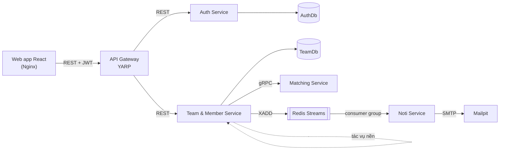

# Hệ thống Quản lý Ghép nhóm EXE

Đồ án cuối kỳ môn **PRN232** — Nhóm 6, lớp SE1920, giảng viên hướng dẫn PhuongLHK.

## Giới thiệu

Ở hai học phần EXE101 và EXE201, sinh viên phải tự lập nhóm khởi nghiệp gồm nhiều chuyên ngành.
Việc ghép nhóm hiện làm thủ công: khó tìm nhóm còn chỗ, nhóm hay sai cơ cấu ngành, một sinh viên có thể
đăng ký nhiều nhóm cùng lúc, và giảng viên khó biết ai chưa có nhóm.

Hệ thống cho sinh viên tự ghép nhóm qua cơ chế **Phòng (Room)**:

1. Sinh viên tạo phòng hoặc vào một phòng đang mở. Người tạo phòng là trưởng phòng.
2. Phòng đủ 3 người thì **khóa**: người đến sau phải gửi đơn để trưởng phòng duyệt.
3. Mỗi sinh viên chỉ ở tối đa một phòng trong một Course; database bảo đảm điều này.
4. Khi phòng thỏa cơ cấu **Loại nhóm (GroupType)** — số thành viên, số ngành, số lượng từng ngành —
   trưởng phòng hoàn tất phòng và phòng trở thành **Nhóm (Group)** chính thức.
5. Mỗi thay đổi quan trọng đều gửi email cho người liên quan.

Mô tả nghiệp vụ đầy đủ (18 quy tắc BR01–BR18, 6 quy trình QT01–QT06):
[docs/Mo_ta_de_tai_He_thong_Ghep_nhom_EXE.docx](docs/Mo_ta_de_tai_He_thong_Ghep_nhom_EXE.docx).

## Kiến trúc



| Service | Vai trò | Giao tiếp |
|---|---|---|
| **Web app** | Giao diện React cho sinh viên, giảng viên, trưởng bộ môn, admin; Nginx chuyển `/api` sang Gateway | HTTP |
| **API Gateway** | Cổng vào duy nhất; kiểm tra JWT rồi chuyển tiếp yêu cầu | REST |
| **Auth Service** | Tài khoản, vai trò, đăng nhập, phát JWT | REST, AuthDb |
| **Team & Member Service** | Dữ liệu nền, Course, phòng, đơn, nhóm; phát sự kiện; chạy tác vụ nền | REST, TeamDb, gRPC client, Redis producer |
| **Matching Service** | Kiểm tra cơ cấu nhóm (BR14, BR15) và gợi ý phòng; không lưu trạng thái | gRPC server |
| **Noti Service** | Đọc sự kiện và gửi email | Redis consumer, SMTP |

Mỗi service có database riêng (database-per-service); Auth và Team chỉ tham chiếu nhau ở mức logic qua
`UserId`. Tài liệu thiết kế chi tiết nằm trong [docs/design](docs/design):
[hợp đồng API](docs/design/api-contract.md), [mô hình dữ liệu](docs/design/data-model.md),
[sự kiện](docs/design/events.md), [Matching Service](docs/design/matching.md),
[quy ước code](docs/design/conventions.md).

### Đáp ứng yêu cầu PRN232

| Yêu cầu | Hiện thực |
|---|---|
| REST API | Auth Service và Team Service: CRUD, kiến trúc phân lớp Controller – Service – Repository, JWT, tìm kiếm, lọc, sắp xếp, phân trang |
| Background Job | `BackgroundService` trong Team Service tự đóng ghép nhóm khi Course quá hạn; Noti Service chạy consumer dưới dạng `BackgroundService` |
| Message Broker | Redis Streams: Team Service là producer, Noti Service là consumer (consumer group, ACK, xử lý lại, dead-letter stream) |
| gRPC | Matching Service, được Team Service gọi khi kiểm tra cơ cấu, hoàn tất phòng và gợi ý phòng |
| Deployment | Docker Desktop + Docker Compose (một trong hai cách đề cho phép): mỗi service một Dockerfile, một lệnh `docker compose up` dựng toàn bộ 9 container — xem mục [Cài đặt và triển khai](#cài-đặt-và-triển-khai) |
| Tài liệu API | Swagger/OpenAPI cho Auth Service và Team Service |
| Database scripts / migrations | EF Core migrations trong `src/AuthService/Data/Migrations` và `src/TeamService/Data/Migrations`, tự áp dụng khi khởi động |
| Làm thêm | Web app React cho 4 vai trò; Matching Service gợi ý phòng; dead-letter stream; kiểm thử end-to-end |

## Công nghệ

- **.NET 8**, ASP.NET Core Web API, C# 12
- **Entity Framework Core 8** + **SQL Server 2022**, migration code-first
- **JWT Bearer** (HS256), phân quyền theo vai trò
- **YARP** làm API Gateway
- **gRPC** (Grpc.AspNetCore) với hợp đồng [`matching.proto`](src/Shared/Contracts/Protos/matching.proto)
- **Redis 7** Streams (StackExchange.Redis)
- **MailKit** gửi email, **Mailpit** làm hộp thư thử nghiệm
- **Swagger** (Swashbuckle), lỗi trả về theo chuẩn **ProblemDetails** (RFC 7807)
- **React 18**, TypeScript, Vite, **Ant Design 5**, React Router; Nginx phục vụ bản build
- **xUnit**, Moq, SQLite in-memory cho test
- **Docker**, Docker Compose

## Cấu trúc thư mục

```
src/
  Shared/Contracts/   matching.proto, định dạng sự kiện, hằng số vai trò
  Shared/Web/         JWT, xử lý lỗi, phân trang, Swagger dùng chung
  Gateway/            API Gateway (YARP)
  AuthService/        Auth Service
  TeamService/        Team & Member Service
  MatchingService/    Matching Service (gRPC)
  NotiService/        Noti Service (worker)
frontend/             Web app React (Vite, Ant Design)
tests/                Unit test cho từng service; tests/e2e: kiểm thử end-to-end
docs/                 Đề bài, mô tả đề tài, tài liệu thiết kế
docker-compose.yml
```

## Cài đặt và triển khai

Hệ thống được triển khai bằng **Docker Desktop với Docker Compose**: một lệnh dựng toàn bộ 9 container
(5 service .NET, web app, SQL Server, Redis, Mailpit) và chúng giao tiếp với nhau qua mạng nội bộ của Compose.

### Yêu cầu

- [Docker Desktop](https://www.docker.com/products/docker-desktop/)
- [.NET SDK 8](https://dotnet.microsoft.com/download/dotnet/8.0) (chỉ cần khi build, test hoặc chạy ngoài Docker)

### Chạy toàn bộ hệ thống bằng Docker Compose

1. Tạo file cấu hình từ mẫu:

   ```bash
   cp .env.example .env
   ```

2. Mở `.env`, đặt `MSSQL_ACCEPT_EULA=Y` nếu bạn đồng ý
   [điều khoản giấy phép của SQL Server](https://go.microsoft.com/fwlink/?linkid=857698).
   Các giá trị còn lại chỉ dùng cho máy cá nhân; đổi chúng nếu triển khai ở môi trường dùng chung.

3. Build và khởi động:

   ```bash
   docker compose up --build -d
   ```

   Lần đầu mất vài phút để tải image và build. SQL Server cần khoảng 30 giây để sẵn sàng; Auth Service
   và Team Service tự tạo database, chạy migration và nạp dữ liệu mẫu khi khởi động.

4. Kiểm tra trạng thái:

   ```bash
   docker compose ps
   ```

| Địa chỉ | Nội dung |
|---|---|
| http://localhost:3000 | **Web app** — đăng nhập bằng tài khoản mẫu bên dưới |
| http://localhost:8080 | API Gateway — mọi lời gọi API đi qua đây |
| http://localhost:5101/swagger | Swagger của Auth Service |
| http://localhost:5102/swagger | Swagger của Team Service |
| http://localhost:8025 | Mailpit — xem mọi email hệ thống đã gửi |

Dừng hệ thống: `docker compose down`. Xóa luôn dữ liệu: `docker compose down -v`.

### Chạy từng service ngoài Docker (để phát triển)

Chỉ chạy hạ tầng bằng Docker, còn các service chạy bằng `dotnet run` (cấu hình nằm trong
`appsettings.Development.json` của từng service):

```bash
docker compose up -d sqlserver redis mailpit
dotnet run --project src/MatchingService
dotnet run --project src/AuthService
dotnet run --project src/TeamService
dotnet run --project src/NotiService
dotnet run --project src/Gateway
```

Frontend ở chế độ phát triển (tự tải lại khi sửa code, proxy `/api` sang Gateway ở cổng 8080):

```bash
cd frontend
npm install
npm run dev
```

rồi mở http://localhost:5173. Mỗi lệnh `dotnet run` và `npm run dev` chạy trong một terminal riêng. Cổng mặc định: Gateway 5000, Auth 5101, Team 5102,
Matching 5103 (gRPC).

### Build và test

```bash
dotnet build ExeTeamMatching.sln
dotnet test ExeTeamMatching.sln
```

### Kiểm thử end-to-end

Khi hệ thống đang chạy bằng Docker Compose với dữ liệu mẫu mới (`docker compose down -v` rồi
`docker compose up -d`), kịch bản sau đi qua Gateway toàn bộ luồng QT01–QT06, các nhánh lỗi BR05, BR09,
BR16, BR18, lời gọi gRPC và email trong Mailpit:

```bash
python tests/e2e/e2e_smoke.py .env
```

### Database và migration

Migration nằm trong `src/AuthService/Data/Migrations` và `src/TeamService/Data/Migrations`, được áp dụng
tự động khi service khởi động. Tạo migration mới:

```bash
dotnet tool restore
dotnet ef migrations add <TenMigration> --project src/TeamService --output-dir Data/Migrations
```

## Dữ liệu mẫu

Mọi tài khoản dùng mật khẩu trong biến `SEED_DEFAULT_PASSWORD` của file `.env`.

| Email | Vai trò |
|---|---|
| `admin@exe.local` | Admin |
| `hod@exe.local` | Trưởng bộ môn |
| `lecturer@exe.local` | Giảng viên |
| `student01@exe.local` … `student12@exe.local` | Sinh viên |

- Sinh viên 01–05 ngành SE, 06–07 ngành AI, 08–10 ngành GD, 11–12 ngành MKT.
- Course `FA26-EXE101` đang mở ghép nhóm, có đủ 12 sinh viên. Course `FA26-EXE201` chưa mở.
- Loại nhóm "Nhóm EXE chuẩn": 4–6 thành viên, ít nhất 3 ngành, SE từ 2 đến 3 người.

## Sử dụng API

1. Đăng nhập qua Gateway để lấy token:

   ```http
   POST http://localhost:8080/api/auth/login
   Content-Type: application/json

   { "email": "student01@exe.local", "password": "<SEED_DEFAULT_PASSWORD>" }
   ```

2. Gửi `Authorization: Bearer <accessToken>` trong các yêu cầu tiếp theo. Trên Swagger, bấm
   **Authorize** và dán token.

Danh sách endpoint, quyền truy cập và mã lỗi: [docs/design/api-contract.md](docs/design/api-contract.md).
Lỗi nghiệp vụ trả mã HTTP 409 kèm trường `code` là mã quy tắc bị vi phạm, ví dụ `BR05` khi sinh viên đã ở
một phòng khác trong Course.

## Hạn chế đã biết

- Sự kiện được phát ngay sau khi lưu database, chưa dùng outbox pattern: nếu Redis lỗi đúng thời điểm đó,
  thông báo của thao tác ấy bị mất (thao tác nghiệp vụ vẫn thành công).
- Chưa có refresh token; access token hết hạn sau 60 phút.
- Chưa có ứng dụng mobile.

## Thành viên và phân công

| Thành viên | MSSV | Phụ trách |
|---|---|---|
| Dương Hạo Cơ | SE194941 | _đang cập nhật_ |
| Vũ Đức Hùng | SE193324 | _đang cập nhật_ |
| Dương Thành Thanh Duy | SE194673 | _đang cập nhật_ |
| Nguyễn Huỳnh Nhật Thịnh | SE194001 | _đang cập nhật_ |
